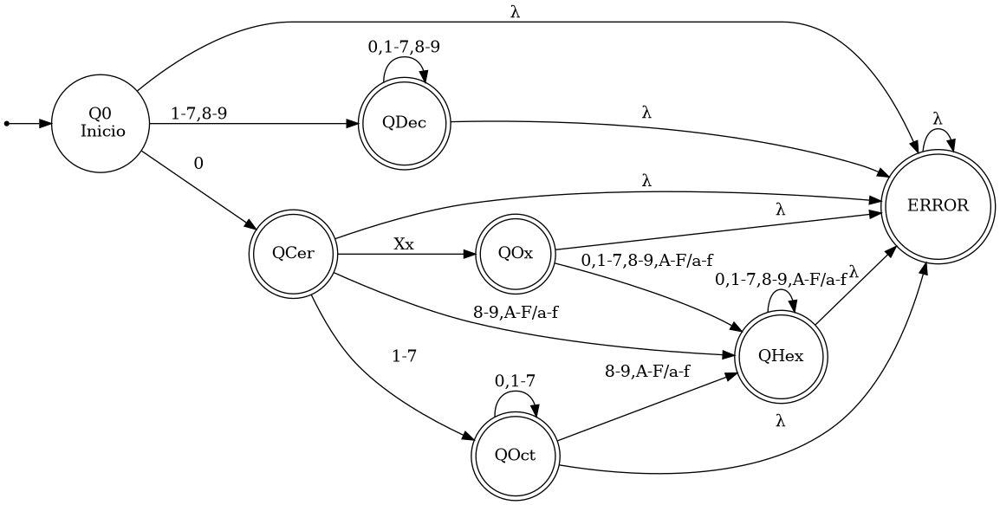

## Tabla de transiciones del AFD

| Estado actual | Entrada         | Siguiente estado |
|:-------------:|:---------------|:---------------:|
| Q0            | 1-9            | Q1              |
| Q0            | 0              | Q2              |
| Q0            | x/X, a-f/A-F   | ERROR           |
| Q0            | otro           | ERROR           |
| Q1            | 0-9            | Q1              |
| Q1            | otro           | ERROR           |
| Q2            | 0              | Q2              |
| Q2            | 1-7            | Q3              |
| Q2            | 8-9            | ERROR           |
| Q2            | x/X            | Q4              |
| Q2            | a-f/A-F, otro  | ERROR           |
| Q3            | 0-7            | Q3              |
| Q3            | otro           | ERROR           |
| Q4            | 0-9, a-f/A-F   | Q5              |
| Q4            | otro           | ERROR           |
| Q5            | 0-9, a-f/A-F   | Q5              |

